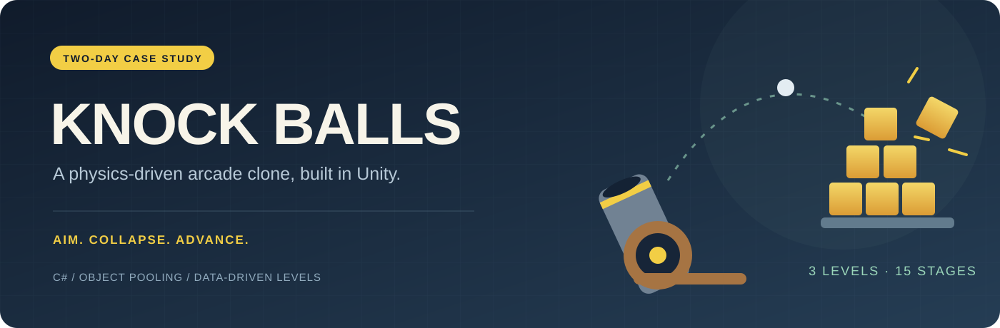
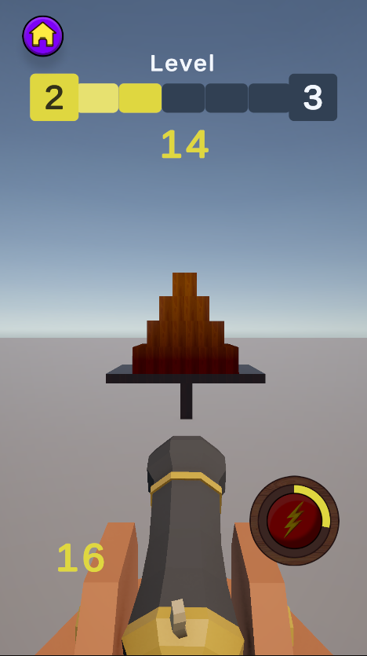
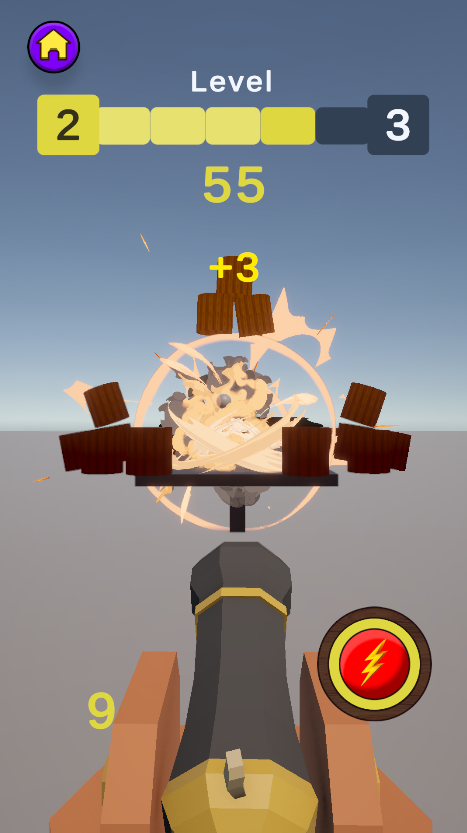
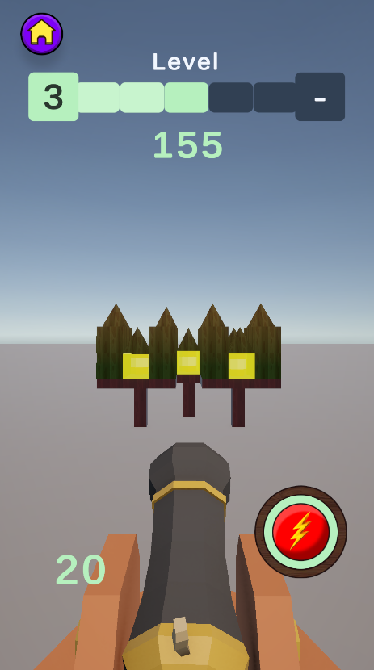

  

  
  
  
  

<a href="README.tr.md">Türkçe</a> · <a href="docs/CASE-STUDY.md">Case study</a> · <a href="docs/ARCHITECTURE.md">Architecture</a> · <a href="docs/ASSET-SETUP.md">Asset setup</a>

# Knock Balls · Clone Case Study

A physics-based recreation of **Knock Balls**, built by **Akif Duman in two days** as a game development case study. Aim a cannon, knock down stacked structures, and clear each stage before running out of ammunition.

The focus was turning a simple arcade loop into a complete prototype: reusable gameplay systems, data-driven levels, satisfying impact feedback, and a readable portrait HUD. The current source also includes later Unity 6.6 compatibility and UI improvements; those maintenance changes are separate from the original two-day case study.

**Publication scope:** this is an open-source **code and project-structure release**. The original commercial/free Asset Store packages and unverified model, texture, UI and audio sources are omitted. Screenshots show the complete local prototype. Restoring those assets is necessary to reproduce that presentation; this checkout is not a standalone playable build. See [asset setup](docs/ASSET-SETUP.md).

## In-game showcase

<table>
  <tr>
    <td width="33%"></td>
    <td width="33%"></td>
    <td width="33%"></td>
  </tr>
  <tr>
    <td><strong>Aim &amp; conserve</strong> Limited ammo makes each shot matter.</td>
    <td><strong>Impact &amp; reward</strong> Physics, explosions and floating scores reinforce the hit.</td>
    <td><strong>Progress &amp; variation</strong> New structures and palette changes distinguish later stages.</td>
  </tr>
</table>

## What is implemented

| System | Implementation |
| --- | --- |
| Cannon gameplay | Mouse aiming, projectile launch, ammo tracking, recoil and camera shake |
| Level progression | **3 main levels / 15 mini levels**, stored in a ScriptableObject level pack |
| Destructible targets | Normal blocks, breakable glass and explosive barrels |
| Power-up | Score-based charging and an armed burst-fire mode |
| Object reuse | Pools for projectiles, blocks, fractured glass, explosion effects and score text |
| Game flow | Main menu, stage completion, final completion, lose countdown and restart |
| Persistence | Best main-level score, saved main-level progress and sound preference |
| Presentation | URP, block color gradients, themed UI, score animations and sound hooks |
| Authoring tools | Scene-marker exporter for level layouts; editor menu for Legacy/Themed UI |

Pooling avoids recreating the same categories of objects for every shot or stage. This is an implementation choice, not a claim of measured FPS or mobile performance.

## Explore the code

- [Projectile and ammo flow](Assets/Scripts/Gameplay/Ball/BallThrowController.cs)
- [Pool implementation](Assets/Scripts/Core/Pooling/GameObjectPool.cs) and [pool lifecycle interface](Assets/Scripts/Core/Pooling/IPoolable.cs)
- [Level data](Assets/Scripts/Gameplay/LevelSystem/Data/LevelPackSO.cs), [level pack](Assets/Levels/LevelPack.asset) and [progression manager](Assets/Scripts/Gameplay/LevelSystem/Runtime/LevelProgressionManager.cs)
- [Power-up and scoring](Assets/Scripts/Gameplay/PowerUp/PowerUpController.cs)
- [Glass fracture](Assets/Scripts/Gameplay/Glass/GlassBlockFractureOnHit.cs) and [explosive barrels](Assets/Scripts/Gameplay/Explosive/ExplosiveBarrelBlock.cs)
- [Theme-aware UI](Assets/Scripts/UI/Theme/GameUIThemeController.cs) and [level layout exporter](Assets/Scripts/Editor/LevelSystem/LevelLayoutExporterWindow.cs)

## Opening the project

1. Clone the repository and add its root folder to Unity Hub.
2. Open it with **Unity 6000.6.4f1**. Unity resolves the dependencies in `Packages/manifest.json`.
3. Install the standard **DOTween** package, then run its setup utility. Camera shake depends on DOTween; it is not bundled here.
4. Import **TMP Essential Resources** through Unity's TextMesh Pro menu.
5. Read [asset setup](docs/ASSET-SETUP.md) before opening `Assets/Scenes/PlayGround.unity`. The scene and prefabs retain references to omitted visual assets.

With the original dependencies restored, use left click to fire, right click + horizontal drag to orbit, and the on-screen power-up button to arm burst fire. UI appearance is available through **Tools → Knock Balls → UI → Themed / Legacy**. Save the scene in Edit Mode to retain the choice.

## Validation and limitations

The complete local project was checked in Unity 6000.6.4f1: compilation, menu pause/resume, play-button events, level/pool initialization, a projectile shot, palette changes and lose/cancel flow. Switching back to Legacy was also verified after saving and reopening a themed scene. [Recorded checks](docs/unity-upgrade-validation.txt).

That validation applies to the local project with its assets present. The stripped public checkout has not been validated as a runnable game. There is no published build, device benchmark or automated Unity CI claim.

## License & credits

Original project code, custom shader and authored project data are released under the [MIT License](LICENSE). Showcase screenshots are presentation material; they do not license the individual art or effects shown in them. Third-party packages retain their own licenses. Details are in [THIRD_PARTY_NOTICES.md](THIRD_PARTY_NOTICES.md).

This is an unofficial educational clone case study. It is not affiliated with or endorsed by the creators or publishers of the original Knock Balls game.

**Author:** [Akif Duman · Akeafea](https://github.com/Akeafea)
