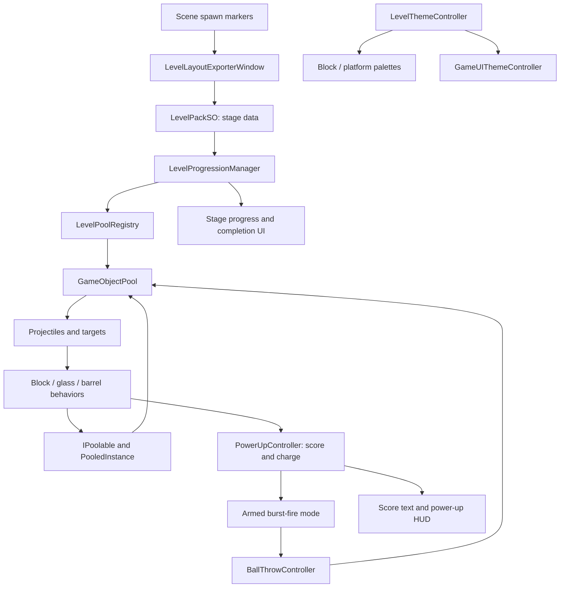

# Architecture and code map

[Back to the project](../README.md)



## Reuse and lifecycle

[`GameObjectPool`](../Assets/Scripts/Core/Pooling/GameObjectPool.cs) owns an available queue and an instance set. A rented object is detached, its rigidbody state is reset, and its `IPoolable.OnSpawned` hooks run. Returning it runs despawn hooks, resets physics, reparents and deactivates it, and makes it available again.

[`PooledInstance`](../Assets/Scripts/Core/Pooling/PooledInstance.cs) gives consumers a return path without requiring them to know which pool owns them. Active-count changes are exposed as events. Expansion and hard limits are configurable per pool.

## Level data and progression

[`LevelPackSO`](../Assets/Scripts/Gameplay/LevelSystem/Data/LevelPackSO.cs) groups main levels and mini levels. Each mini level contains its ammo budget and spawn instructions: pool key, position, rotation and scale.

[`LevelPoolRegistry`](../Assets/Scripts/Gameplay/LevelSystem/Runtime/LevelPoolRegistry.cs) maps those keys to pools. [`LevelProgressionManager`](../Assets/Scripts/Gameplay/LevelSystem/Runtime/LevelProgressionManager.cs) loads the instructions, tracks active targets, handles transition/completion flow and saves main-level progress and best main-level score.

[`LevelLayoutExporterWindow`](../Assets/Scripts/Editor/LevelSystem/LevelLayoutExporterWindow.cs) converts scene `LevelSpawnMarker` components into serialized spawn instructions. Open it through **Tools → KnockBalls → Level Layout Exporter**.

## Shooting, scoring and feedback

- [`BallThrowController`](../Assets/Scripts/Gameplay/Ball/BallThrowController.cs): input gating, aim direction, fire delay, ammo, launch velocity and recoil.
- [`PowerUpController`](../Assets/Scripts/Gameplay/PowerUp/PowerUpController.cs): destruction-event subscriptions, score display, charge state and burst-fire coroutine.
- [`BlockGroundRecycle`](../Assets/Scripts/Gameplay/Block/BlockGroundRecycle.cs): score notification, shrink animation and return on ground contact.
- [`GlassBlockFractureOnHit`](../Assets/Scripts/Gameplay/Glass/GlassBlockFractureOnHit.cs): impact detection and pooled fracture handoff.
- [`ExplosiveBarrelBlock`](../Assets/Scripts/Gameplay/Explosive/ExplosiveBarrelBlock.cs): impact-triggered explosion, nearby-body forces and effect/audio hooks.
- [`ScoreGainTextPoolController`](../Assets/Scripts/UI/Score/ScoreGainTextPoolController.cs): temporary floating score feedback.
- [`GlobalSfx2D`](../Assets/Scripts/Gameplay/Audio/GlobalSfx2D.cs): shared sound playback and saved sound preference.

## UI and theme boundaries

[`LevelThemeController`](../Assets/Scripts/Gameplay/Theme/LevelThemeController.cs) owns the world palette and exposes an accent for the interface. [`GameUIThemeController`](../Assets/Scripts/UI/Theme/GameUIThemeController.cs) applies that accent while retaining serialized originals for graphic colors, typography, sprites, click targets and selected layout properties.

The UI controller supports Edit Mode and Play Mode. Its editor menu sets **Legacy / Themed**; the saved choice is scene data. Palette updates do not replace gameplay controllers or their event wiring.

## Repository layout

```text
Assets/
  Scripts/
    Core/Pooling/          Pool contracts and implementation
    Gameplay/              Cannon, targets, progression, effects and themes
    UI/                    Menu, score, sound, stage bars and UI appearance
    Editor/                Level exporter and UI appearance commands
  Levels/                  The 3-main-level / 15-mini-level pack
  Scenes/                  Authored PlayGround scene; external references retained
  Prefabs/                 Authored prefab configurations
  Materials/               Material and physics settings; source textures omitted
  Shaders/                 Custom world-height block gradient
  Animations/              UI animation data
  Settings/                URP configuration
Packages/                   Unity Package Manager declarations
ProjectSettings/            Unity project configuration
docs/                       Case study, dependency notes and showcase images
```

See [asset setup](ASSET-SETUP.md) for the difference between this source checkout and the complete local prototype.
