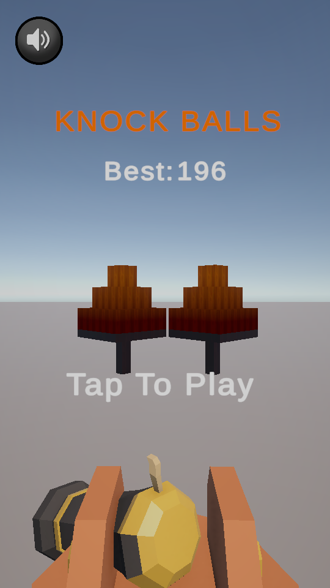
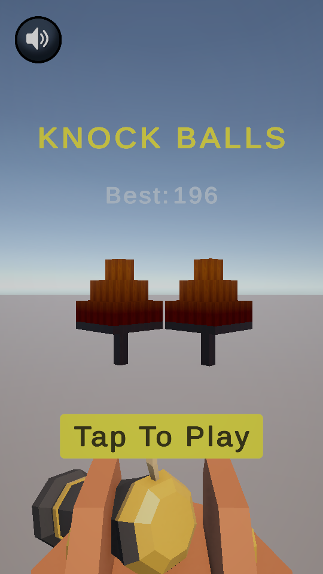

# Two days to a complete arcade loop

[Back to the project](../README.md) · [Architecture](ARCHITECTURE.md)

## Context

**Developer:** Akif Duman  
**Original development time:** two days  
**Project:** unofficial Knock Balls clone, built as a Unity game development case study

The challenge was to reproduce the essential interaction—aim, fire, collapse a structure—then connect it to a complete progression loop within a short timebox. The result contains three main levels with five mini levels each, limited ammunition, target variations, a charged burst-fire ability and game-state UI.

The Unity 6.6 migration and reversible UI styling in this repository are later maintenance work. The two-day statement refers to the original case study, not the maintenance work or repository preparation.

## Gameplay priorities

### Make each shot readable

The player sees the target, remaining ammunition, score and stage progress in a portrait layout. Projectile motion, cannon recoil, camera shake and impact audio help communicate the shot. Floating score text connects destruction to its reward.

### Give targets different consequences

Normal blocks recycle when they reach the ground. Glass targets swap into a pooled fractured representation. Explosive barrels affect nearby targets and trigger a pooled explosion effect. These behaviors give the same cannon mechanic different outcomes without introducing a separate control scheme.

### Let the loop extend through data

The level pack stores the ammo budget, pool keys and transform instructions for each stage. A scene-marker exporter writes layouts into that pack. Main-level progression updates the palette, while saved progress and best-score tracking support returning to the prototype.

## Engineering decisions

| Decision | Why it fits this case study | Tradeoff |
| --- | --- | --- |
| Shared object pools | Projectiles, targets, fragments and feedback objects have repeated lifecycles | Every pooled component must reset its state correctly |
| ScriptableObject level pack | Layouts and ammo budgets can be edited independently of progression logic | Authoring depends on consistent pool keys and marker setup |
| Event-based scoring | Block, glass and barrel events can feed scoring without putting HUD logic into collision handlers | Static event subscriptions need explicit cleanup |
| Optional audiovisual references | Gameplay behaviors expose references for audio, shake and effects | Scene setup still requires deliberate wiring |
| Existing art/VFX dependencies | Keep the short case study focused on game systems and feel | Original visual assets cannot automatically be redistributed with the code |

No device performance measurements were supplied. Pooling and shared materials are architectural choices; they are not evidence of a particular frame rate.

## Later maintenance

- Updated object searches for Unity 6.6 and repaired DOTween import configuration in the local project.
- Added UI colors that follow the active level palette.
- Reorganized the menu and introduced rounded UI surfaces and improved text contrast.
- Corrected lose-screen scaling for the portrait reference resolution.
- Preserved original UI properties so **Legacy / Themed** can be selected in the editor, including after saving and reloading a scene.

<table>
  <tr><td width="50%"></td><td width="50%"></td></tr>
  <tr><td><strong>Legacy</strong> — preserved original layout.</td><td><strong>Themed</strong> — updated menu and palette.</td></tr>
</table>

## Verification scope

The complete local project passed compilation and a short Play Mode smoke check on Unity 6000.6.4f1. Checks covered menu pause/resume, level/pool initialization, the play-button event, firing, theme changes and lose/cancel flow. Original UI colors, layouts, sprites and click targets were checked after a themed save/reload.

The asset-stripped source release is provided for code review and adaptation. It is not a tested standalone distribution. No claim is made about store release, production readiness, long-session stability or mobile benchmarking.

## Further work

Useful next steps would be a redistributable replacement art set, a standalone demo build, device profiling and longer progression/restart testing. They are future work, not features claimed by this repository.
